# FMXWayland

A native Wayland platform for Delphi FireMonkey (FMX) on Linux, written in Object Pascal — without Embarcadero's
closed `libfmux.so` and without GTK. FMX programs talk to the Wayland compositor directly (libwayland-client and
libxkbcommon, loaded at run time) and draw into shared-memory buffers with FMX's default Linux canvas (cairo and
Pango, as with libfmux) or, optionally, with its Skia canvas.

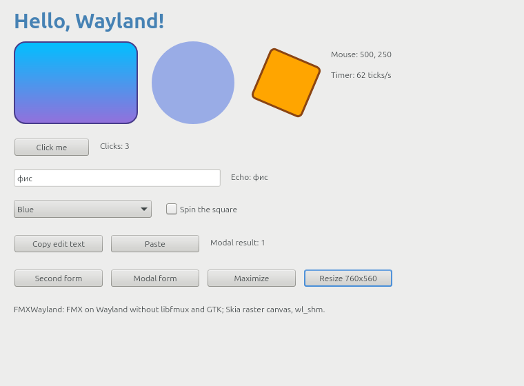

Phase 1 (this state): an FMX program with the usual controls runs on WSLg, Weston, sway, KWin and GNOME Shell —
windows, popups, mouse, keyboard, clipboard, timers, modal forms, message boxes, file dialogs (the desktop's through
xdg-desktop-portal, FMX's own without one), HiDPI scale (integer and fractional), xdg-activation, server-side or
client-side decorations or a title bar drawn by the program itself
([IFMXWaylandWindowFrame](#ifmxwaylandwindowframe-for-programs-with-their-own-title-bar)), the desktop's font as
FMX's default, on both of FMX's Linux canvases (cairo/Pango and Skia) and on
[FastCanvas](#fastcanvas-vulkan), a GPU canvas that presents to the windows' surfaces through Vulkan
(`VK_KHR_wayland_surface`). See [Dialogs](#dialogs), [Compositors](#compositors), [Status](#status) and
[What does not work](#what-does-not-work-yet).

## How it works

FMX for Linux (`FMX.Platform.Linux`, `FMX.Canvas.Linux`, `FMX.Clipboard.Linux`, `FMX.Skia.Canvas`, ...) calls the
closed library libfmux (a GTK 3 wrapper) through the ~186 function-pointer variables of the unit `FMUX.Api`. The
precompiled FMX units accept another `FMUX.Api` with the same interface section, so FMXWayland generates one at build
time (`tools\gen-fmux-api.ps1`):

- the **interface section** is copied verbatim from the local Delphi installation
  (`$(BDS)\source\fmx\FMUX.Api.pas`). It is Embarcadero's code: the generated file is never committed
  (`.gitignore`);
- the **implementation section** is FMXWayland's: every function pointer first gets a generated stub with the
  declared signature (logs its name once, returns zero/nil/False), then `FMXWayland.Fmux.AssignFmuxApi` assigns the
  implemented functions; the helper routines of the interface (`FmuxStateToShiftState`, `MsgDlgButtonsToButtons`,
  ...) are in `src\FMXWayland.FmuxApi.inc`. There is no libfmux resource and no `dlopen` of libfmux.

The platform logic of `FMX.Platform.Linux` (forms, menus loop, text service, ...) stays Embarcadero's; FMXWayland
implements what libfmux did:

| Unit | What it is |
|---|---|
| `FMXWayland.Fmux` | The FMUX functions: windows (`TFmuxWindow` forwards Wayland events to FMX's callbacks), the paint context, bitmaps, timers, the loop, clipboard, modal loops, message boxes and file dialogs (through the dialog backend), `IFMXWaylandNativeWindow` |
| `FMXWayland.Cairo`, `FMXWayland.CairoApi` | FMX's default Linux canvas (`FMX.Canvas.Linux`) served by the FMUX canvas, text layout, bitmap codec and font functions on the system's cairo, Pango and gdk-pixbuf (loaded with `dlopen` on first use); contributed by [Hemul GM](https://github.com/HemulGM) |
| `FMXWayland.Platform` | The Wayland side, independent of FMX: connection and globals, outputs, the event loop (display fd + eventfd for wake-ups + timers + watched descriptors, `prepare_read`/`read_events` so other readers such as Vulkan WSI can share the display), `TWlWindow` (xdg_toplevel / xdg_popup, wl_shm double/triple buffering, frame callbacks, damage, scale, client-side decorations, export with xdg-foreign), pointer, keyboard (xkbcommon keymap, key repeat, compose/dead keys), cursors (cursor-shape-v1 or an Xcursor theme through libwayland-cursor), clipboard (wl_data_device) |
| `FMXWayland.Dialogs`, `FMXWayland.DialogTypes`, `FMXWayland.Portal`, `FMXWayland.DBus`, `FMXWayland.FileDialog` | Dialogs behind a replaceable backend: file dialogs through the xdg-desktop-portal FileChooser (over a small D-Bus client in Pascal, no libdbus), FMX's own file dialog form when there is no portal, message dialogs and input queries with FMX's forms (see [Dialogs](#dialogs)); contributed by [Hemul GM](https://github.com/HemulGM) |
| `FMXWayland.Wayland`, `FMXWayland.Xkb`, `FMXWayland.WaylandCursor` | Bindings of libwayland-client, libxkbcommon, libwayland-cursor, loaded with `dlopen`: programs start without link-time dependencies and say what is missing |
| `src\Protocols\FMXWayland.Protocol.*` | Generated from the protocol XML files in `protocols\` by `tools\gen-wayland.ps1`, a small wayland-scanner for Pascal |
| `FMXWayland.Keys` | XKB keysyms / evdev codes -> FMX virtual keys |
| `FMXWayland.Native` | `IFMXWaylandNativeWindow`, the contract for GPU canvases (below) |
| `FMXWayland.FmuxLoad` | Calls `FMUX.Api.LoadLib` from `FMUX.Api`'s implementation uses, before FMX's units that call the FMUX functions initialize, whatever unit a program reaches first (the cycle `FMUX.Api` → `FMXWayland.Fmux` → FMX → `FMX.Platform.Linux` → `FMUX.Api` otherwise let `FMX.Platform.Linux` call `FmuxSetLog` while it was nil) |
| `FMXWayland.Frame` | `IFMXWaylandWindowFrame`, the contract for programs that draw their own title bar (below) |
| `FMXWayland.SystemFont` | FMX's `IFMXSystemFontService`: the default font of `TFont` (GNOME's `font-name` through the settings portal, else fontconfig's `sans-serif`) |

**Painting.** Both of FMX's Linux canvases work; the frames go to the compositor as wl_shm buffers, attached with the
damaged rectangle and committed; frame callbacks pace the repaints.

- **FMX's default canvas** (`FMX.Canvas.Linux`, `TLinuxCanvas`: what an FMX program uses unless it sets
  `GlobalUseSkia`) calls the FMUX canvas functions (paths, fills, strokes, gradients, clips, bitmaps), text layouts and
  bitmap codecs. libfmux implemented them with cairo, Pango and gdk-pixbuf; `FMXWayland.Cairo` does the same on the
  system's libraries. The paint context is a cairo context over the window's retained frame: FMX repaints only the
  damaged region, and each wl_shm buffer (they rotate, so a buffer holds an older frame) gets the regions that changed
  since its frame. Text is antialiased in grayscale (a Wayland client does not know the subpixel order of the screen).
- **The Skia raster canvas** (`FMX.Skia`, `GlobalUseSkia := True`, `libsk4d.so` next to the program) gets the frame
  as its context, renders the window into an FMUX bitmap (plain memory) and copies it with `FmuxCanvasDrawBitmap`.
- **A GPU canvas** that presents itself ([FastCanvas](#fastcanvas-vulkan): Vulkan through `VK_KHR_wayland_surface`)
  takes the window's `wl_surface` through [IFMXWaylandNativeWindow](#ifmxwaylandnativewindow-contract-for-gpu-canvases)
  and turns FMXWayland's frames off for it; FMXWayland keeps the window's viewport, geometry and decorations in step
  with the commits of the canvas's presenting thread.

The two draw the same layout; antialiasing, hinting and Pango's line spacing differ a little
(`tests\canvas-check.ps1` puts both side by side, below).

**Coordinates.** Wayland clients do not know where their windows are. Every window keeps a virtual origin (what FMX
set with `SetWindowRect`); `ClientToScreen`/`ScreenToClient` and the screen positions of mouse events use it, so
FMX's own conversions stay consistent. Popups (combo box lists, popup menus — FMX forms with `FormStyle = Popup`)
become xdg_popups placed relative to their parent (the form of their placement target) and take the position the
compositor gives them.

**Decorations.** With `zxdg_decoration_manager_v1` the compositor draws the title bar (KWin, sway). Without it
(WSLg, Weston, GNOME), or when the compositor answers "client-side" (sway with `border csd`), FMXWayland draws
client-side decorations: a subsurface around the window with the title (rendered by FMX's canvas), minimize/maximize/
close buttons (those the window manager offers in `xdg_toplevel.wm_capabilities`: sway has neither maximize nor
minimize), moving, resizing at the edges and the window menu. FMX's form rectangle includes them, like a frame on
other platforms. `FMXWAYLAND_CSD=0` turns them off; a program can turn off both kinds for a window and draw its own
title bar ([IFMXWaylandWindowFrame](#ifmxwaylandwindowframe-for-programs-with-their-own-title-bar)). A press on the
title starts the compositor's interactive move only when the pointer is dragged past 4 pixels (as GTK does), so a
click or a double click stays the window's.

**Fonts.** FMX's default font (`TFont`, every control whose style names no family) is the desktop's
(`IFMXSystemFontService`; without it FMX falls back to "Tahoma", which Linux systems do not have: Skia then fell back
to "Ubuntu", Pango to fontconfig's default). In a GNOME session (`XDG_CURRENT_DESKTOP` lists GNOME) it is GNOME's
interface font, `org.gnome.desktop.interface font-name` ("Adwaita Sans 11"), read through the settings portal
(`org.freedesktop.portal.Settings`, `ReadOne` or the older `Read`, over the D-Bus client of the dialogs): the family
as fontconfig resolves it (a substitute when that family is not installed), the size converted from points to FMX's
device-independent pixels (11 pt = 14.7, as Windows reports its 9 pt message font as 12). Elsewhere, without a
portal (it is given 1.5 seconds) or with `FMXWAYLAND_PORTAL=0`, it is the desktop's sans-serif font as fontconfig
resolves it at FMX's default size of 12 (libfmux registers no such service: FMX used 12 there too).
`FMXWAYLAND_FONT="family[,size]"` overrides both.

## Dialogs

`TOpenDialog`, `TSaveDialog` and `SelectDirectory` (FMX calls `FmuxFilesDialog`) and FMX's synchronous message
dialogs (`FmuxMessageDialog`) go to a **dialog backend** (`FMXWayland.Dialogs`, `IFMXWaylandDialogBackend` in
`FMXWayland.DialogTypes`). The default one:

- **File dialogs through xdg-desktop-portal** (`org.freedesktop.portal.FileChooser`, the desktop's own dialog: GNOME,
  KDE, GTK), over a private connection to the session bus made by a small D-Bus client in Pascal
  (`FMXWayland.DBus`: Unix socket, SASL EXTERNAL, the wire format; no libdbus). Filters, the chosen filter, the
  initial folder and name, multiple selection, folders (FileChooser version 3) are passed on. The program's window is
  exported with **xdg-foreign** (`zxdg_exporter_v2`) and named as the dialog's parent (`wayland:<handle>`), so the
  compositor keeps the dialog above it (GNOME, KWin, sway have it; without it the parent is ''). While the dialog is
  open the program's loop goes on (painting, timers, threads: the bus socket is one more descriptor of the event
  loop's poll) and its windows take no input, as under a modal form. When the program ends meanwhile, its request is
  closed and the dialog goes away.
- **FMX's own file dialog** (`FMXWayland.FileDialog`, an FMX form: folders and files with the filter, hidden files,
  new folder, the location typed, multiple selection, overwrite question) when there is no portal: no session bus,
  no xdg-desktop-portal, no FileChooser in it, folder selection with FileChooser before version 3, or
  `FMXWAYLAND_PORTAL=0`. The fallback is immediate when the portal is not there (the bus says so); a portal that does
  not answer is given 5 seconds.
- **Message dialogs** with FMX's own dialog form, as before.

Another backend replaces it (for example own forms), and then also serves `TDialogService` (message dialogs and input
queries, synchronous and asynchronous); `nil` restores the default:

```pascal
uses FMXWayland.Dialogs, FMXWayland.DialogTypes;

type
  TMyDialogs = class(TFMXWaylandDialogBackend)
  public
    function FileDialog(const Request: TWaylandFileDialogRequest; out Files: TArray<string>;
      var FilterIndex: Integer): Boolean; override;
  end;

SetWaylandDialogBackend(TMyDialogs.Create);
```

Limits: FMX reads the result of `FmuxFilesDialog` from a buffer of 1024 characters, so a multiple selection keeps
the names that fit (a warning in the log names how many); `GetWaylandDialogBackend.FileDialog` has no such limit. The
portal's dialogs ask before overwriting whatever `ofOverwritePrompt` says (GTK and KDE always do). Under GNOME
50 the portal's file dialog is Nautilus (xdg-desktop-portal-gnome hands it over), which refuses to run as root.

| GNOME Shell 50: the portal's dialog (GTK) as a child of the program's window | KWin 6.6: the portal's dialog (KDE) | FMX's own file dialog (no portal) |
|---|---|---|
| 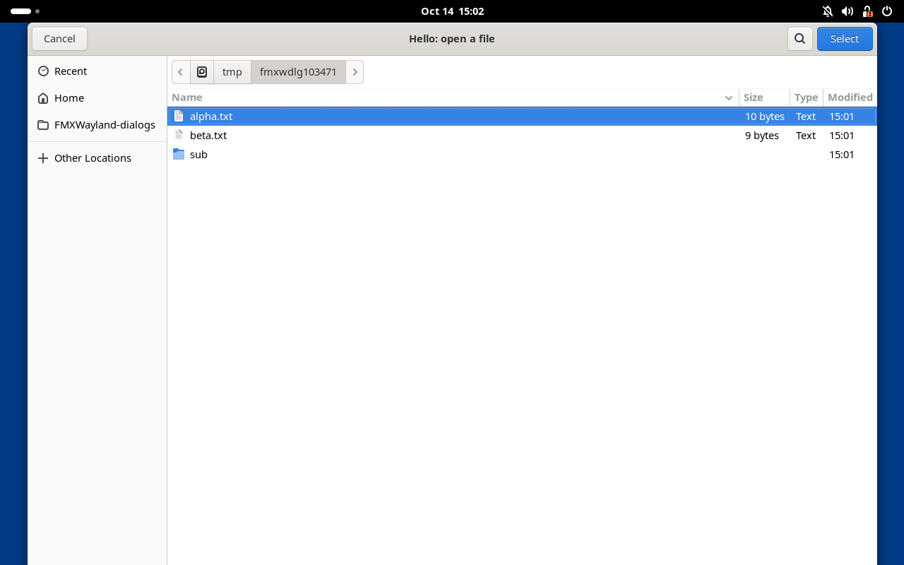 | 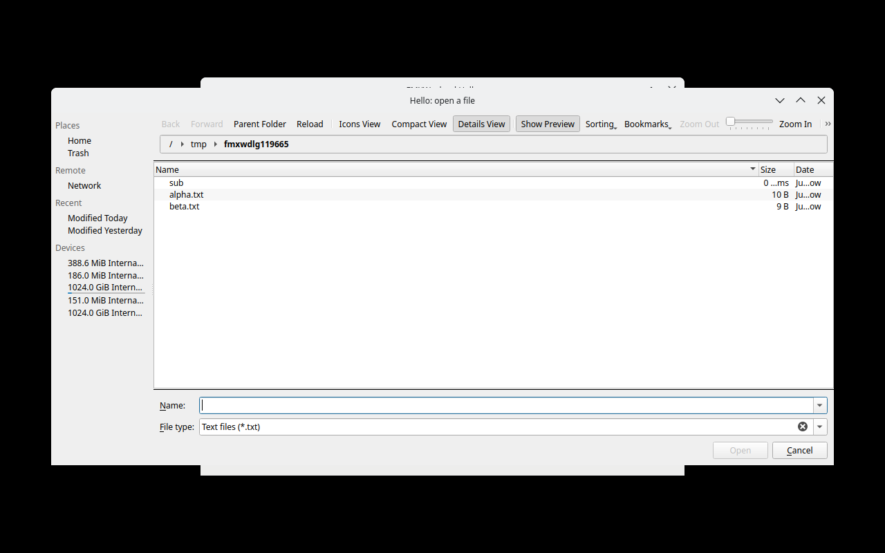 | 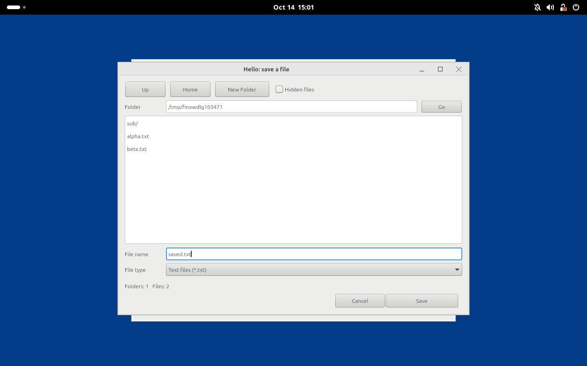 |

## Requirements

- Delphi 13 (RAD Studio 37.0) with the Linux platform (Enterprise/Architect) and FMX for Linux with its sources:
  in Delphi 13.0 part of the product (`source\fmx\FMUX.Api.pas`, units in `lib\linux64`), in later releases (13.1) a
  GetIt package in the catalog repository. `tools\delphi-env.ps1` finds the `FMUX.Api.dcu` the build uses (the
  Linux64 library path of the IDE, then the catalog repository, then `lib\linux64`) and the `FMUX.Api.pas` next to it:
  the generated interface must be the one those precompiled FMX units were compiled with. `gen-fmux-api.ps1 -Source`
  overrides it.
- A Linux platform SDK to link against: `tools\make-linux-sdk.ps1` makes one from a WSL distribution (or use the
  IDE's SDK manager). The default is Ubuntu 22.04's: programs need glibc 2.35 or later (Ubuntu 22.04+, Debian 12+,
  Fedora 36+, ...; see [Tests](#tests), `tests\glibc-compat.ps1`).
- At run time: a Wayland compositor with `wl_compositor`, `wl_shm` and `xdg_wm_base`; the libraries
  libwayland-client0 and libxkbcommon0 (libwayland-cursor0 for cursors on compositors without cursor-shape-v1); for
  FMX's default canvas cairo, Pango, pangocairo and gdk-pixbuf with fontconfig and fonts (Debian/Ubuntu: `libcairo2
  libpango-1.0-0 libpangocairo-1.0-0 libgdk-pixbuf-2.0-0`, present on any desktop); with the Skia canvas instead,
  `libsk4d.so` (Skia, `$(BDS)\Redist\linux64`) next to the program. No GTK, no X11, no libfmux. For the desktop's file
  dialogs a session bus with xdg-desktop-portal and a backend with a FileChooser (xdg-desktop-portal-gnome,
  -kde, -gtk; any desktop has one); without them FMX's own file dialog is used.

## Using it in a project

1. Generate `FMUX.Api.pas` (`.\tools\gen-fmux-api.ps1 -Out <dir>\FMUX.Api.pas`) and put `<dir>`, `src` and
   `src\Protocols` **first** on the unit search path (the IDE/`dcclinux64` then compile it instead of linking
   Embarcadero's precompiled `FMUX.Api`).
2. That is all for FMX's default canvas (cairo). For the Skia canvas instead, in the .dpr:

   ```pascal
   uses
     System.StartUpCopy, FMX.Forms, FMX.Types, FMX.Skia, MainForm in 'MainForm.pas';
   begin
     GlobalUseSkia := True;
     Application.Initialize;
     ...
   ```

Nothing else changes in the program. `samples\Hello\Hello.dproj` does this with `..\..\gen` (generate with
`-Out gen\FMUX.Api.pas`); Hello uses Skia unless it is built with the define `NOSKIA`.

3. For [FastCanvas](#fastcanvas-vulkan) (Vulkan) instead: its folders after FMXWayland's on the search path, and in
   the .dpr, as on any platform:

   ```pascal
   uses
     System.StartUpCopy, FMX.Forms, FastCanvas.Device, FastCanvas.Canvas, FastCanvas.Context3DVk, ...;
   begin
     FastCanvasBackend := TFastCanvasBackend.Vulkan;
     InstallFastCanvas;
     InstallFastContext3DVk;
     Application.Initialize;
     ...
   ```

   Hello does this with the define `FASTCANVAS` (`samples\Hello\HelloFastCanvas.pas`).

## Building

```powershell
.\tools\make-linux-sdk.ps1 -CreateDistro -Install    # once: libc, crt*.o, libgcc, libz of Ubuntu 22.04 (WSL)
.\tools\build.ps1 -Project samples\Hello\Hello.dpr   # Release; -Config Debug
.\tools\build.ps1 -Project samples\Hello\Hello.dpr -Define NOSKIA -BuildRoot D:\Work\FMXWayland-build\cairo
.\tools\build.ps1 -Project samples\Hello\Hello.dpr -Define FASTCANVAS -BuildRoot D:\Work\FMXWayland-build\fastcanvas `
  -SearchPath F:\Projects\FMXFastCanvas\src\Canvas,F:\Projects\FMXFastCanvas\third_party\pasvulkan\src
```

The SDK decides the oldest glibc the program runs with. `make-linux-sdk.ps1` copies it out of a WSL distribution
(default `Ubuntu-22.04` into `D:\LinuxSDK\ubuntu-22.04`; `-CreateDistro` installs the distribution first when it is
missing, without the first-run prompt: `wsl --install -d Ubuntu-22.04 --no-launch --web-download --location
D:\WSL\Ubuntu-22.04`; `-Install` installs `libc6-dev`, `libgcc-<n>-dev` and `zlib1g-dev` in it). Linked against it,
Hello needs `GLIBC_2.34` at most and `libsk4d.so` `GLIBC_2.29`. Another SDK stays selectable:
`make-linux-sdk.ps1 -Distro Ubuntu-26.04 -Install` makes `D:\LinuxSDK\ubuntu-26.04` (glibc 2.43), `build.ps1 -Sdk
D:\LinuxSDK\ubuntu-26.04` links against it.

`build.ps1` generates `FMUX.Api.pas` into `<BuildRoot>\gen`, compiles with `dcclinux64` (linking with its lld against
the SDK: `--syslibroot`, `--libpath`), copies `libsk4d.so` next to the program when it links FMX's Skia units (its
map file lists `System.Skia.API`; a program on FMX's default canvas needs none). Everything goes to `-BuildRoot`
(default `D:\Work\FMXWayland-build`: `bin\Linux64\<Config>\`, `dcu\`). It also works around the missing Linux64
`FMX.Filter.res` of Delphi 13. msbuild builds the .dproj too, given the SDK:

```
msbuild samples\Hello\Hello.dproj /p:Config=Release /p:Platform=Linux64 /p:DCC_SysLibRoot=<sdk>
  /p:DCC_LibraryPath=<bds>\lib\linux64\release%3B<sdk>\usr\lib\x86_64-linux-gnu%3B<sdk>\usr\lib\gcc\x86_64-linux-gnu\<n>
```

The protocol units are committed; after adding or updating an XML file in `protocols\` run `.\tools\gen-wayland.ps1`.

## Running

On WSLg (Windows 11, WSL 2):

```sh
export XDG_RUNTIME_DIR=/mnt/wslg/runtime-dir WAYLAND_DISPLAY=wayland-0
unset DISPLAY
./Hello --verbose
```

Environment variables: `FMXWAYLAND_LOG` = 0 errors only, 1 warnings and "not implemented" notes (default), 2 debug,
3 input traces; `FMXWAYLAND_DUMP_DIR=<dir>` writes the latest frame of each window as a BMP (debugging);
`FMXWAYLAND_CSD=0` no client-side decorations; `FMXWAYLAND_APP_ID` the xdg app id (default: the program name);
`FMXWAYLAND_PORTAL=0` FMX's own file dialogs instead of the portal's (and no settings portal for the font);
`FMXWAYLAND_FONT="family[,size]"` FMX's default font (size in device-independent pixels); `XCURSOR_THEME`,
`XCURSOR_SIZE` for cursor themes.

## Tests

- `tests\hello-e2e.ps1` — end to end on WSLg with **real input**: it moves the Windows mouse and types (WSLg forwards
  Windows input to its compositor over RDP, so events take the real wl_pointer/wl_keyboard path), takes screenshots
  of the windows and checks the program's log: pointer, button clicks, typing (any keyboard layout), editing keys,
  Ctrl+A/Ctrl+X, mouse wheel, clipboard both ways (WSLg shares it with Windows), combo box popup, check box, second
  form, modal form (the main window must not react meanwhile), close request from the compositor, the close and
  maximize buttons of the client-side title bar, maximize/restore, resize from code, clean exit. Needs an
  interactive desktop nobody else is using (it takes the mouse for about a minute).
- `tests\weston-headless.ps1` — non-interactive: the sample on a private headless Weston 14 at output scale 1 and
  2 (buffer size through `IFMXWaylandNativeWindow`, the self-test steps up to a message box answered by a timer, file
  dialogs without a session bus — FMX's own, driven by timers: the folder listed through the filter without hidden
  files, two files of a multiple selection, save over an existing file with another filter and the overwrite
  question, a folder, cancel —, the program's frame dumps, a compositor screenshot, clean exit), the default font
  (fontconfig's family at 12; `FMXWAYLAND_FONT` with a serif family: the canvas measures the default text in it),
  popups opened before their window is mapped (`Hello --early-popup`, `=paint`, `=create`: the drop-down and the
  window must both be on the screen, counted in the screenshot's pixels) and `Hello --own-titlebar --selftest` (the
  window frame service without input, no FMXWayland title bar in the screenshot). `-BuildRoot <root of a NOSKIA
  build> -Canvas TLinuxCanvas` runs it on FMX's default canvas, `-BuildRoot <root of a FASTCANVAS build> -Canvas
  TFastCanvas` on FastCanvas (the frame dump is then the frame FastCanvas presented: FMXWayland has none of such a
  window). The self-test also hides the second form and shows it again (the window configured twice), and fails on an
  exception the program got (`Application.OnException` writes it to the log).
- `tests\canvas-check.ps1` — builds `tests\CanvasCheck` for both canvases and runs them on headless Weston at scale 1
  and 2: the same drawing (gradients, opacity, dashes and caps, bitmap brushes, scaled and partial bitmaps, the PNG
  codec, text beyond the BMP, wrapping, alignment, trimming, styles, rotation, text as a path, a degenerate matrix),
  checks of what the program measures (positions around a surrogate pair, PtInPath, the PNG round trip) and the two
  frames side by side, Skia left, cairo right.
- `tests\dialog-check.ps1` — builds `tests\DialogCheck` and runs it on headless Weston with a private session bus:
  the D-Bus client against the real dbus-daemon (an address list with a missing socket first, an abstract socket,
  `guid=`, `unix:runtime=yes`, a non-Unix address; SASL EXTERNAL; strings, arrays and a dictionary of variants; an
  error reply's name; a timeout; a subscribed signal; a pump that cancels; no portal: unavailable after 1 ms) and the
  dialog backend with a test backend (what `TOpenDialog`, `TSaveDialog`, `SelectDirectory`, `TDialogService` and
  the FMUX dialog functions hand it and get back; 20 of 30 long names fit into FMX's buffer; `nil` restores FMX's
  dialog services) and the default font (Pango font descriptions; GNOME's `font-name` through a settings portal on
  two more private buses, `tests\settings-portal.py`: `ReadOne`, and an old portal with only `Read`; asked only in a
  GNOME session and not with `FMXWAYLAND_PORTAL=0`; a missing key; no portal: fontconfig at once).
- `tests\glibc-compat.ps1` — the glibc symbol versions Hello and `libsk4d.so` need (`objdump -T`, at most 2.35),
  then Hello's self-test on the headless Weston of other distributions in Docker containers (no screen, no GPU;
  images with the run-time libraries, built once as `fmxwayland-compat:<image>`): `ubuntu:22.04` (glibc 2.35,
  Weston 9), `debian:12` (glibc 2.36, Weston 10), `fedora:latest` (Fedora 44, glibc 2.43, Weston 15) by default;
  `-Images` takes others. Needs Docker Desktop (Linux containers). On glibc 2.31 (Debian 11) the loader refuses the
  program (`GLIBC_2.34 not found`).

- `tests\compositors.ps1` — the sample on real compositors started headless in WSL (nothing on the desktop, no
  Windows input): see [Compositors](#compositors).

Evidence of the last runs: all checks of the first two passed (WSLg on Windows 11 with Ubuntu 26.04, Weston 14.0.2
headless), and all of `glibc-compat.ps1` with the program linked against the Ubuntu 22.04 SDK (2026-10-14);
`Hello --selftest` also runs to the end on WSLg (its seat appears only after the RDP client connects, a second or so
after the program starts: the clipboard falls back to a process-local one until then). With the dialogs and the
window frame service merged and GNOME's font: `weston-headless.ps1` passed on both canvases (153 checks each: Skia,
cairo), `dialog-check.ps1` 36, `canvas-check.ps1` 36, `glibc-compat.ps1` 74 (Ubuntu 22.04, Debian 12, Fedora 44);
the end-to-end test on WSLg was not run again (it takes the Windows desktop). With FastCanvas (2026-10-14, after the
changes for it): `weston-headless.ps1` 157 checks on each canvas (Skia, cairo, FastCanvas), `canvas-check.ps1` 36,
`dialog-check.ps1` 36, all passed; `compositors.ps1` with FastCanvas 1028 passed (8 runs, all parts), with Skia 966
(7 runs, all parts; GNOME Shell at 1.5 once more after its shell stayed busy and took no pointer input in the first
run), with cairo 184 (sway, KWin, GNOME Shell at 1.5: self-test, own title bar, popups of unmapped windows), none
failed.

| | |
|---|---|
| 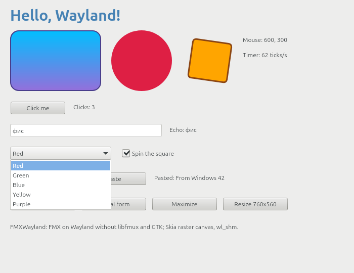 | 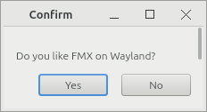 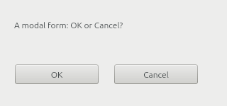 |

Headless Weston, output scale 2 (2x rendering, client-side decorations, the combo box drop-down as an xdg_popup):

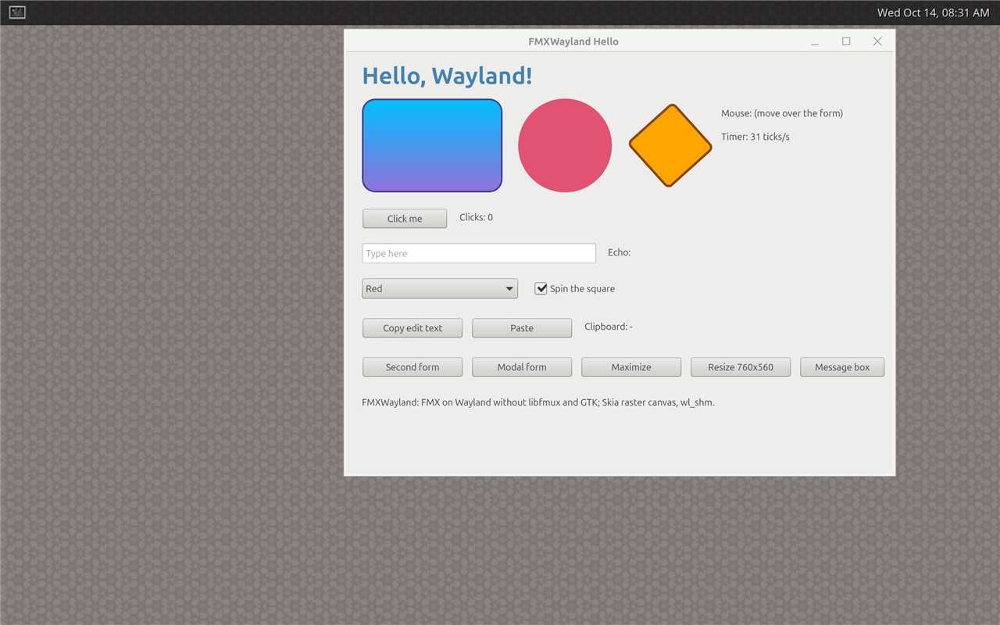

FMX's default canvas (cairo and Pango, `-Define NOSKIA`) on headless Weston, and `tests\canvas-check.ps1` (Skia
left, cairo right): weston-headless and canvas-check passed with both canvases at scale 1 and 2, and the self-test of
both runs to the end on headless sway 1.11 too (which tiles the window: its size there is sway's, not 700x540)
(2026-10-14).

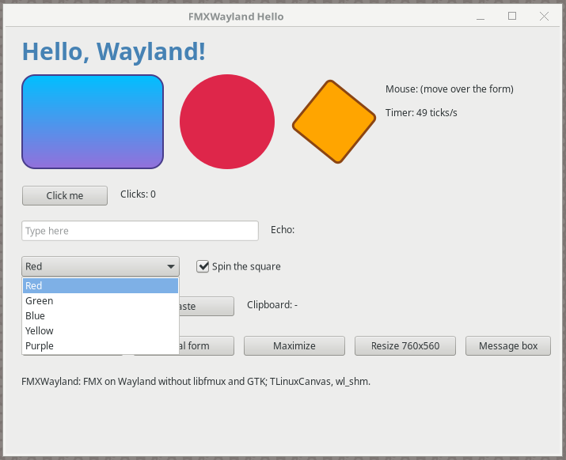

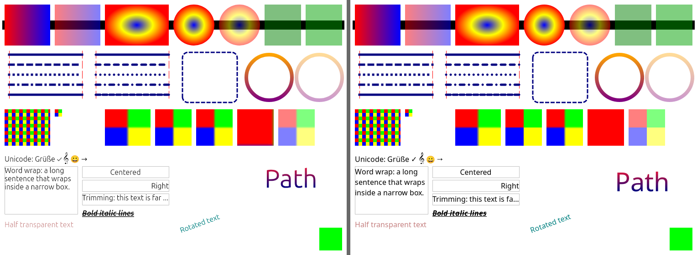

## Compositors

`tests\compositors.ps1` starts each compositor headless in WSL (Ubuntu 26.04: its own runtime directory, home and
D-Bus session; nothing appears on the desktop and no Windows input is used), runs `samples\Hello` on it and checks
its log, the compositor's view of the windows and screenshots:

1. `Hello --selftest` (the checks of `tests\weston-headless.ps1`: threads, clipboard, the combo box drop-down,
   second form, maximize/restore, modal loop, buffer size at the scale, frame dump) with a compositor screenshot while
   the drop-down is open;
2. where the compositor can be driven from outside, a scenario with input as a user gives it (`tests\wltool.py`, a
   small Wayland client speaking the wire protocol, plus D-Bus): three clicks on a button, typing into `TEdit`,
   Backspace, Home, End, Ctrl+A, Ctrl+X, Shift, the wheel both ways, the clipboard both ways with another application
   (data-control on sway and KWin, `St.Clipboard` on GNOME Shell), the combo box popup (placed where the program asked,
   then an item clicked at its place), the check box, a second form (focused; its "Activate main form" button
   activates the main form with xdg-activation from a click's serial; closed by the compositor), the close button of
   the program's own title bar, a modal form (the main form must not react to a click meanwhile), FMX's own file
   dialogs (the program's session bus has no portal: a double click opens a file, a typed name saves, Escape
   cancels), maximize/restore from the program, from the compositor and from the program's title bar, resize from code
   (the compositor must see the new size), close of the main form by the compositor and a clean exit;
3. `Hello --own-titlebar --selftest` (`IFMXWaylandWindowFrame` without input: decorations off, the listener at once
   and after the configure, nothing started without a press, a drop-down of the undecorated window, maximize/restore
   through the service, decorations on and off again; a screenshot without FMXWayland's title bar) and, where the
   compositor can be driven, `Hello --own-titlebar` with input: no decorations (the compositor's frame equals the
   window geometry and the client area), a drag on the caption moves the window, a drag on the corner grip resizes
   it, the maximize button and a double click maximize and restore it to its size and place, a right click shows the
   compositor's window menu (screenshot), another window takes and gives back the activation (listener), a popup at
   its place, minimize and the compositor showing the window again, the close button;
4. popups opened before their window is mapped (`Hello --early-popup`, `=paint`, `=create`): an xdg_popup of the
   main window once that is mapped, not dismissed, both on the screen (pixels of the screenshot; on compositors that
   activate the new window FMX closes the popup again, see [What does not work](#what-does-not-work-yet)); on GNOME
   Shell these programs run on the session's bus, and their default font must be GNOME's `font-name` read through
   the settings portal;
5. on sway, KWin and GNOME Shell the **portal's file dialog**: xdg-desktop-portal started by D-Bus activation in the
   run's session with the compositor's backend (sway: xdg-desktop-portal-gtk; KWin: -kde; GNOME Shell: -gtk, since
   xdg-desktop-portal-gnome hands file dialogs to Nautilus, which does not run as root): the request, the program's
   window exported with xdg-foreign as the parent and the dialog its child for the compositor (KWin, GNOME Shell
   report it), the program's loop running meanwhile and its main window ignoring the compositor's close, a file chosen
   by typing its path, a name typed into the save dialog, Escape, `Request.Close` from another client refused by the
   portal, the program ending while a folder dialog is open (its request closed, the dialog gone), a clean exit.
   What cannot be automated: a click into the portal's dialog at a known place (its layout is the toolkit's; the
   keyboard answers it), and the program's windows under it (the dialogs cover them on a 1280x800 output).

The self-test and the scenario run on a private session bus without services (no portal: FMX's own file dialogs),
the other parts on the run's session bus. `-Parts` picks some of `selftest, frame-selftest, early, scenario, frame,
portal`.

| | Weston 14 | sway 1.11 | sway 1.11 `border csd` | KWin 6.6 | GNOME Shell 50 (Mutter) |
|---|---|---|---|---|---|
| Headless | `--backend=headless` | `WLR_BACKENDS=headless` | the same | nested in a headless sway (`--virtual` too: self-test only) | `--headless --virtual-monitor` |
| Input, window queries | none (self-test only) | wlr virtual pointer/keyboard, `swaymsg` | the same | `org_kde_kwin_fake_input`, KWin scripts | Clutter virtual devices through `org.gnome.Shell.Eval` |
| Screenshots | `weston-screenshooter` | grim | grim | grim of the host sway | `org.gnome.Shell.Screenshot` |
| Title bar | the program's | sway's (xdg-decoration) | the program's (xdg-decoration "client-side") | KWin's Breeze (xdg-decoration) | the program's |
| Scale 1, 2 | pass, pass | pass, pass | pass, — | pass, pass | pass, pass |
| Fractional 1.5 (wp-fractional-scale-v1) | not offered | pass | pass | pass | pass (`gdctl`, `scale-monitor-framebuffer`) |
| Self-test | pass | pass (maximize n/a) | pass (maximize n/a) | pass | pass |
| Pointer, keyboard, shortcuts, wheel | — | pass | pass | pass | pass |
| Clipboard with another application, both ways | — | pass | pass | pass | pass |
| Popup placed where asked, item clicked | self-test | pass | pass | pass | pass |
| xdg-activation | not offered | pass (`focus_on_window_activation focus`) | pass | pass | pass |
| Second form, close by the compositor | self-test | pass | pass | pass | pass |
| Close button of the program's title bar | — | n/a | pass | n/a | pass |
| Modal form, main form blocked | self-test | pass | pass | pass | pass |
| FMX's own file dialogs (no portal): double click opens, typed name saves, Escape | self-test (no bus) | pass | pass | pass | pass |
| The portal's file dialog (backend) | not run | pass (xdg-desktop-portal-gtk) | pass (-gtk) | pass (-kde) | pass (-gtk: -gnome's Nautilus does not run as root) |
| Its parent: the program's window through xdg-foreign | — | exported (sway does not report the relation) | exported | pass | pass |
| Meanwhile: the program's loop runs, its main window ignores a close | — | pass | pass | pass | pass |
| Keyboard answers (path, name), Escape, the program ending during a dialog | — | pass | pass | pass | pass |
| Maximize/restore: program, compositor, title bar | self-test | n/a (no maximize in sway) | n/a | pass, pass, n/a | pass, pass, pass |
| Resize from code | — | pass | pass | pass | pass |
| Close by the compositor, clean exit | — | pass | pass | pass | pass |
| Default font (fontconfig's sans-serif) | pass | pass | pass | pass | pass |
| Default font in GNOME: `font-name` through the settings portal ("Adwaita Sans 11": fontconfig's family, 14.7) | — | — | — | — | pass |
| Popups opened before the window is mapped (`--early-popup`, `=paint`, `=create`) | pass, both on the screen | pass (FMX closes them at the activation) | pass (likewise) | pass (likewise) | pass (likewise) |
| Own title bar, self-test: no decorations, listener, maximize, decorations on and off | pass | pass (maximize n/a) | pass (maximize n/a) | pass | pass |
| Own title bar with input: move, resize, activation, popup, close button | — | pass | pass | pass | pass |
| Own title bar: maximize/restore by button and double click, back to size and place | — | n/a | n/a | pass | pass |
| Own title bar: the compositor's window menu, minimize | — | n/a | n/a | pass | pass |
| [FastCanvas](#fastcanvas-vulkan) (Vulkan, `VK_KHR_wayland_surface`): all of the above at 1, 2 (Weston), 1.5 | pass (1, 2) | pass (1, 1.5) | not run | pass (1, 1.5) | pass (1, 1.5) |

Last run (2026-10-14, WSL 2 with Ubuntu 26.04, the program linked against the Ubuntu 22.04 SDK, with the dialogs and
the window frame service merged and GNOME's font through the settings portal): 14 runs (Weston 1, 2; sway 1, 2, 1.5;
sway `border csd` 1, 1.5; KWin 1, 2, 1.5; KWin `--virtual` 1; GNOME Shell 1, 2, 1.5) with all parts, 1751 checks
passed, 51 not applicable (maximize, minimize and the window menu on sway; on each run with the portal a click on the
program's window under the portal's dialog, which covers it), none failed (31 minutes). The branches had run 946
(dialogs) and 1366 (window frame) checks before. KWin's `--virtual` backend renders with QPainter, and its
screenshot interface (`org.kde.KWin.ScreenShot2`) needs OpenGL, which WSL cannot give it (no DRM render node): the
test runs KWin nested in a headless sway (KWin's Wayland backend, its window fullscreen there; KWin takes the host
output's scale), and KWin `--virtual` for the self-test alone. GNOME Shell runs with a test extension
(`tests\gnome-test-extension`) that turns on its unsafe mode, which lets the test call `org.gnome.Shell.Eval` and
`org.gnome.Shell.Screenshot`, and hides the overview after the startup animation (it takes the input otherwise).

What the runs found and what was fixed: a window below a modal form that the compositor activated (the user clicked
it) made FMX ask to activate it again, a loop of activation requests that kept the modal form from getting its OK
click (sway, KWin, GNOME); the modal form gets the activation now. Title bar buttons follow
`xdg_toplevel.wm_capabilities` (sway offers neither maximize nor minimize). FMX learns the new window rectangle when
the compositor switches the decoration mode (sway's `border csd`; sway keeps the window's outer size, so the client
area is 692x506 there). FMX resizes its canvas and realigns a form only when its window rectangle changes size, so
when only the client area changes inside a window of the same outer size (decorations switched by the compositor or
by the program), FMXWayland does those steps of `SetBounds` itself (FMX's file dialog had its buttons cut off on
sway with `border csd`; an own title bar turned on and off left the form aligned to the old client area). Popups are
placed where asked on all of them (`popup configure x,y (asked x,y)` in the debug log). With the window frame
service: GNOME Shell put a maximized window that a double click on the program's caption restored at the top left
corner (under its top bar) when the first click had started a move; moves now start on the drag. `SetDecorated`
before the first show reported the window's provisional size to FMX and so replaced the size the program had given
the form (FMR Ribbon's RibbonBasic opened at 632x446 instead of 1180x640); it only records the choice then now. A
popup made before its parent was mapped is made once the parent is (FMR Ribbon saw both windows stay invisible on
Weston that way; in these runs Weston showed both even before the fix, the protocol requires the order). The portal
part found what the portals need in a session without a desktop session manager: `XDG_CURRENT_DESKTOP` and
`XDG_SESSION_TYPE=wayland` (else xdg-desktop-portal-gnome serves settings only), the compositor's display in the
D-Bus activation environment before the compositor starts (GNOME Shell and KWin start the portal at once), Qt's
Wayland shell integration (`qt6-wayland`) for xdg-desktop-portal-kde; xdg-desktop-portal-gtk answers Escape with
response 2, and xdg-desktop-portal 1.21 refuses `Request.Close` from another client.

Running it (in Ubuntu 26.04: `apt install weston sway grim kwin-wayland kwin-common kwin-style-breeze gnome-shell
mutter python3-dbus wayland-utils`, for the portal part `xdg-desktop-portal xdg-desktop-portal-gtk
xdg-desktop-portal-kde xdg-desktop-portal-gnome qt6-wayland`):

```powershell
.\tools\build.ps1 -Project samples\Hello\Hello.dpr
.\tests\compositors.ps1                            # all; -Runs gnome:1.5, kwin:2 for some (<compositor>:<scale>)
```

Results: `D:\Work\FMXWayland-build\shots\compositors\<compositor>-<scale>\` (`results-all.txt`, `steps.log`, the
program's logs, screenshots, frame dumps) and `summary.md` there (the matrix of all checks).

| KWin 6.6 at 1.5 (server-side title bar, combo box popup) | GNOME Shell 50 at 1.5 (the program's title bars, modal form) | sway at 1.5 with `border csd` (only a close button: sway has no maximize) |
|---|---|---|
| 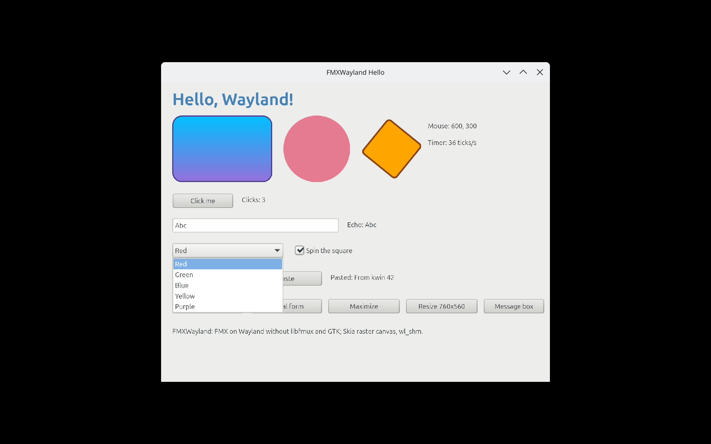 | 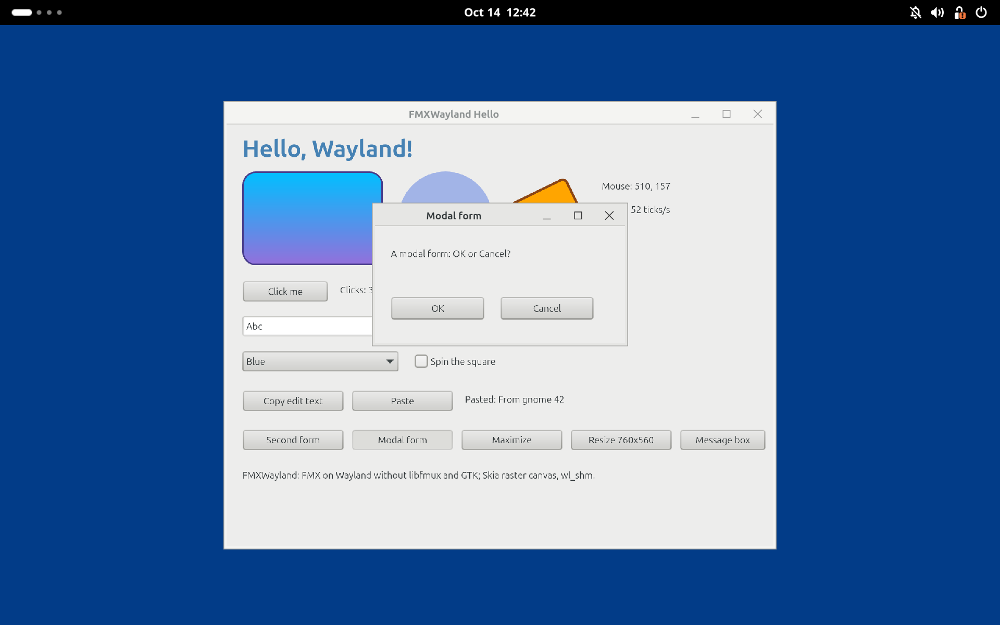 | 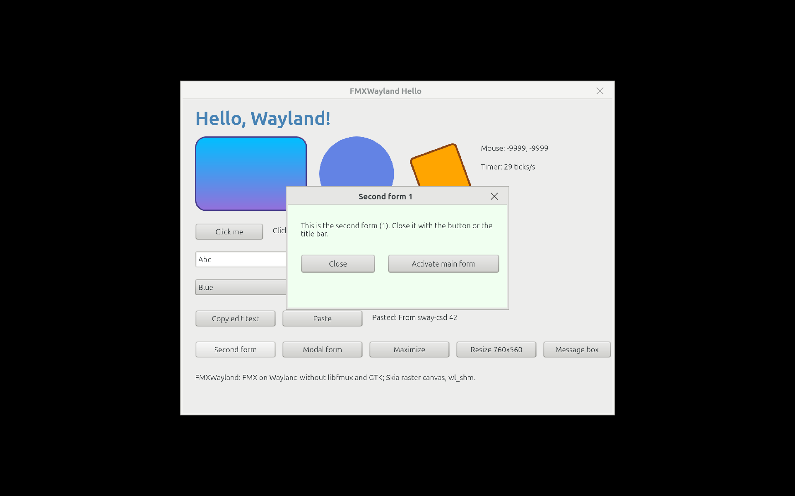 |
## FastCanvas (Vulkan)

[FastCanvas](https://github.com/Fasday/FMXFastCanvas) (FMX canvas and 3D context on Vulkan, Direct3D 11/12) runs on
FMXWayland natively: its windows present to their `wl_surface`s through `VK_KHR_wayland_surface`, with no GTK, X11,
Skia or libfmux. Neither project depends on the other: FastCanvas declares
[IFMXWaylandNativeWindow](#ifmxwaylandnativewindow-contract-for-gpu-canvases) again and takes the Wayland path when
the service is there (on FMX's GTK platform it presents to X11 windows as before).

- Toplevel windows (forms, modal forms, dialogs, `TForm3D`): a Vulkan surface on the window's `wl_surface`, swap
  chains of the buffer size FMXWayland reports, presented by a thread of FastCanvas (Mesa's WSI reads its own event
  queue there), `MAILBOX` (else `IMMEDIATE`; never Wayland's `FIFO`, which blocks in the present on frame callbacks a
  hidden window never gets). FMXWayland keeps calling FMX's paint; FMX paints when it invalidates.
- Popups (combo box lists, menus) and transparent forms go through FMXWayland's frames: FastCanvas reads them back
  and hands them over with `FmuxCanvasDrawBitmap` (FMXWayland makes a popup's `xdg_popup` again at every show and
  move, which a presenting thread could not follow).
- Before FMXWayland unmaps a window FastCanvas stops presenting to it (it wraps FMX's window service), and the first
  frame of a window shown is presented before FMX's paint returns; FMXWayland applies the window's viewport, geometry
  and decorations before the presenter's next commit (see the contract below).
- Building: `tools\build.ps1 -Define FASTCANVAS -SearchPath
  <FastCanvas>\src\Canvas,<FastCanvas>\third_party\pasvulkan\src` for Hello; FastCanvas's own probes with its `tools\build-linux.ps1 -Wayland <FMXWayland folder>`. Running needs
  `libvulkan1` and a Vulkan driver with `VK_KHR_wayland_surface` (Mesa's; lavapipe on the CPU presents through
  `wl_shm`), and Pango, HarfBuzz, fontconfig, FreeType for FastCanvas's text.
- Tested (2026-10-14, WSL 2 with Ubuntu 26.04, Mesa 26.0.8's lavapipe, the only Vulkan device there): Hello with
  FastCanvas passes `tests\weston-headless.ps1 -Canvas TFastCanvas` (157 checks, Weston 14 at scale 1 and 2: the
  self-test with the combo box drop-down, the second form hidden and shown again, maximize and restore, the modal
  form, the message box, FMX's file dialogs; the default font; the popups of unmapped windows; the own title bar) and
  `tests\compositors.ps1 -Canvas TFastCanvas` on Weston 1 and 2, sway 1 and 1.5, KWin 1 and 1.5, GNOME Shell 1 and
  1.5 with all parts (self-test, scenario with input and the clipboard, own title bar with input, popups of unmapped
  windows, the portal's file dialogs): 1028 checks passed, 22 not applicable, none failed. The Vulkan validation layer
  (with synchronization validation) reports nothing for the self-test on Weston and on sway at 1.5 (23 scale changes),
  for FastCanvas's PortProbe (its scene, the Vulkan 3D context's cube with ray-traced shadows, ambient occlusion and
  reflections, FMX effects; resized from code 42 times at scale 2) and for its Form3DProbe (a `TForm3D` window with
  its own swap chain). What the runs found and fixed is in the commits: the viewport, the configure's state before
  the presenter's commits (Weston's `invalid_surface_state` on maximize), the window mapped after its first paint,
  toplevels hidden and shown again (Weston sent no configure to an unmapped toplevel that kept its role: any canvas),
  the form's canvas made again on scale changes (a new window starts at the output's integer scale), the
  initialization order of `FMUX.Api` (`FMXWayland.FmuxLoad`), and in FastCanvas a click into an empty `TEdit`.
- Frame rate and CPU on the same scene (FastCanvas's PortProbe without its cube, 480x840, headless Weston at scale 1,
  20 s; lavapipe renders on the CPU, so only the relations mean something): repainted at once, FastCanvas 123.5 FPS
  at 2.44 CPU seconds per second (19.8 ms per frame, lavapipe's threads included; 0.3 ms of it recording on the main
  thread), FMX's cairo canvas 39.5 FPS at 0.17 (4.3 ms per frame; FMXWayland's frame callbacks pace it), the Skia
  raster canvas 24.4 FPS at 0.79 (32.5 ms, one thread); with a 16 ms timer 62.0 FPS at 1.28, 39.4 at 0.15, 23.9 at
  0.79.

| KWin 6.6 at 1.5: Hello on FastCanvas (the drop-down read back into FMXWayland's frame) | PortProbe on Weston: shapes, Pango text with emoji, the Vulkan 3D context's cube | Form3DProbe on Weston: a `TForm3D` with ray-traced shadows and ambient occlusion |
|---|---|---|
|  | 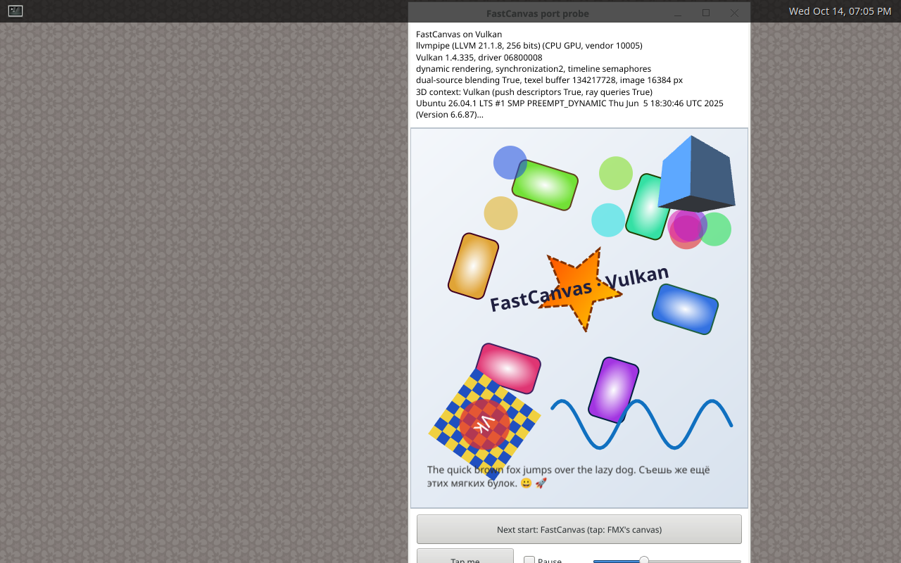 | 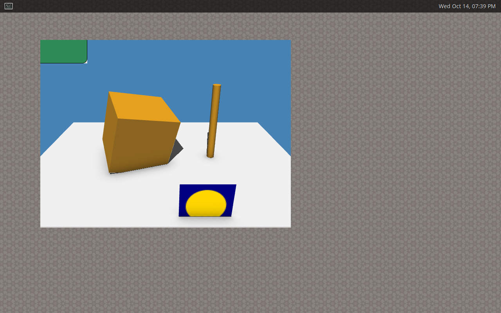 |

## IFMXWaylandNativeWindow (contract for GPU canvases)

A GPU canvas (FastCanvas on Vulkan) creates its own `VkSurfaceKHR` for a window with
`vkCreateWaylandSurfaceKHR(wl_display, wl_surface)`. FMXWayland registers, when it connects (in `FmuxInit`, during
the initialization of `FMX.Platform`), an FMX platform service:

```pascal
type
  IFMXWaylandNativeWindow = interface
    ['{B04A2FBC-1322-42BC-98A6-D526A7854F2C}']
    function GetWaylandDisplay: Pointer;                                   // wl_display*
    function GetWaylandSurface(const AHandle: TWindowHandle): Pointer;     // wl_surface*, nil if not an FMXWayland window
    function GetBufferSize(const AHandle: TWindowHandle): TSize;           // buffer pixels = client size x scale
    function GetScale(const AHandle: TWindowHandle): Single;               // buffer pixels per logical pixel
    procedure SetExternalPresentation(const AHandle: TWindowHandle; const AValue: Boolean);
  end;
```

A library that must not depend on FMXWayland declares the same interface (same GUID, same methods in the same order,
same signatures; Delphi's default calling convention) and asks with
`TPlatformServices.Current.SupportsPlatformService(IFMXWaylandNativeWindow, Svc)` (`samples\Hello` does exactly
that). Never change this declaration; extensions get a new interface with a new GUID. The rules:

- The `wl_surface` is the window's content surface: it lives as long as the FMX window handle (also across
  hide/show; popups get new xdg_popup objects at each show, the surface stays). Its size is the client area — the
  client-side decorations are a separate subsurface.
- `GetBufferSize`/`GetScale` change on resize and scale changes; FMX resizes its canvas then (form resize, and
  `TScaleChangedMessage` for scale changes).
- `SetExternalPresentation(Handle, True)`: FMXWayland keeps calling FMX's paint (the canvas renders and presents in
  `EndScene` or later, from a thread of its own), but stops attaching its own wl_shm frames. The surface gets a
  `wp_viewport` (where the compositor has `wp_viewporter`, all tested ones do) whose destination is the window's
  logical size, with buffer scale 1: a buffer of any size the presenter commits is valid and fills the window (a
  frame painted before a resize or a scale change; without the viewport an odd-sized buffer at buffer scale 2 would
  be a protocol error). FMXWayland still owns the viewport, the window geometry and the decoration subsurface; that
  state is double-buffered and takes effect with whichever commit of the presenter (`vkQueuePresentKHR`) comes next.
  So that any such commit is valid for the configure acknowledged before it, FMXWayland sends that state right next
  to the acknowledgement, before FMX hears of the configure (into maximized or fullscreen the new geometry first, out
  of it the acknowledgement first: Weston raises `invalid_surface_state` when a maximized window's geometry is not
  the configured size), and again before every paint. There are no frame callbacks of FMXWayland then: FMX paints
  when it invalidates (its animations and timers), the presenter paces its own frames.
- The window counts as mapped (its popups are made, `CanParentPopups`) once the first paint after it was shown has
  returned: the presenter should have committed that frame by then (FastCanvas waits until its first frame of a
  window is presented).
- Before FMXWayland unmaps a window (FMX hides the form: `FmuxShowWindow(False)`, which attaches no buffer) the
  presenter must have stopped presenting to it, and it must not present again before FMXWayland paints the window
  after the compositor configured it again (a buffer committed to an unmapped xdg_surface is a protocol error).
  FastCanvas wraps FMX's `IFMXWindowService` for this (`HideWindow`, `ReleaseWindow`). FMXWayland itself unmaps
  popups when they move or resize (a new xdg_popup), which no presenter can follow: present popups through
  FMXWayland's frames (FastCanvas reads their frames back into the paint context with `FmuxCanvasDrawBitmap`).
- Everything is on the main thread; FMXWayland dispatches only the default event queue, with the
  `wl_display_prepare_read` protocol, so Vulkan WSI's own queue can coexist (Mesa's WSI reads and dispatches its
  queue on the presenting thread).

## IFMXWaylandWindowFrame (for programs with their own title bar)

A program that draws its own title bar (FMR Ribbon's integrated caption and tab row, a Chrome-like tab strip, ...)
needs the platform to stop decorating its window and to start interactive moves and resizes for it:
`xdg_toplevel.move`/`resize`/`show_window_menu` need the `wl_seat` and the serial of the pressing input event, which
only the platform has. FMXWayland registers this FMX platform service in `FmuxInit`, next to
`IFMXWaylandNativeWindow`. The declaration is FMR Ribbon's (`Source\Frame\FMR.Frame.Wayland.pas`, its
`Docs\LINUX.md`); FMXWayland has it in `FMXWayland.Frame`. A program declares the same interfaces (same GUIDs, the
same methods in the same order, the same signatures, Delphi's default calling convention) and asks with
`TPlatformServices.Current.SupportsPlatformService(IFMXWaylandWindowFrame, Svc)`; neither depends on the other. Never
change it; extensions get a new interface with a new GUID.

```pascal
const
  { Edges of BeginResize: the values of xdg_toplevel.resize_edge. }
  FmxwEdgeNone = 0; FmxwEdgeTop = 1; FmxwEdgeBottom = 2; FmxwEdgeLeft = 4; FmxwEdgeTopLeft = 5;
  FmxwEdgeBottomLeft = 6; FmxwEdgeRight = 8; FmxwEdgeTopRight = 9; FmxwEdgeBottomRight = 10;
  { Bits of GetStates: 1 shl <xdg_toplevel.state> of the last configure. }
  FmxwStateMaximized = 1 shl 1; FmxwStateFullscreen = 1 shl 2; FmxwStateResizing = 1 shl 3;
  FmxwStateActivated = 1 shl 4; FmxwStateTiledLeft = 1 shl 5; FmxwStateTiledRight = 1 shl 6;
  FmxwStateTiledTop = 1 shl 7; FmxwStateTiledBottom = 1 shl 8; FmxwStateSuspended = 1 shl 9;
  { Bits of GetCapabilities: 1 shl <xdg_toplevel.wm_capabilities>; FmxwCapsUnknown before xdg_wm_base 5. }
  FmxwCapWindowMenu = 1 shl 1; FmxwCapMaximize = 1 shl 2; FmxwCapFullscreen = 1 shl 3; FmxwCapMinimize = 1 shl 4;
  FmxwCapsUnknown = Cardinal($FFFFFFFF);

type
  IFMXWaylandWindowFrameListener = interface
    ['{785C5760-E413-4153-82DF-E857D1AA70AC}']
    procedure WindowFrameChanged(const AHandle: TWindowHandle; const AStates, ACapabilities: Cardinal);
  end;

  IFMXWaylandWindowFrame = interface
    ['{547B5786-5639-43A4-A598-1A03B465783A}']
    procedure SetDecorated(const AHandle: TWindowHandle; const AValue: Boolean);
    function GetDecorated(const AHandle: TWindowHandle): Boolean;
    function BeginMove(const AHandle: TWindowHandle): Boolean;
    function BeginResize(const AHandle: TWindowHandle; const AEdges: Cardinal): Boolean;
    function ShowWindowMenu(const AHandle: TWindowHandle; const AClientPoint: TPointF): Boolean;
    procedure Minimize(const AHandle: TWindowHandle);
    procedure SetMaximized(const AHandle: TWindowHandle; const AValue: Boolean);
    function GetStates(const AHandle: TWindowHandle): Cardinal;
    function GetCapabilities(const AHandle: TWindowHandle): Cardinal;
    procedure SetFrameListener(const AHandle: TWindowHandle; const AListener: IFMXWaylandWindowFrameListener);
  end;
```

`AHandle` is the form's `Handle`. Handles that are not toplevels of FMXWayland (popups, foreign handles): the methods
do nothing and return False/0. Main thread only.

| Method | What FMXWayland does |
|---|---|
| `SetDecorated(H, False)` | No decorations at all: the client-side title bar (subsurface) goes, and where the compositor has xdg-decoration it is asked for `client_side` (KWin and sway draw none then). Kept for the window: configures, the compositor's decoration answers and hide/show do not bring them back. The window geometry is the surface (`set_window_geometry(0, 0, w, h)`), `DecorationInsets` are 0, FMX's window rectangle is the client rectangle. **Before the window's first show** (a form's constructor, `FormCreate`, FMR's frame attaching to a new form) only the choice is recorded: nothing is reported to FMX and the window's size is not touched, so the `Width`/`Height` the program gave the form (before or after the call) stay and become the client area when the form is shown (FMX keeps a form's size to itself until its first show and sets it then). **Once the window has been shown** it keeps its outer size and place (the client area takes the room of the decorations; a maximized window must keep the configured size) and FMX gets the new bounds and realigns; a hidden window keeps its client size. `True`: the platform's choice again (`server_side` asked, or its own title bar), with the same rules. |
| `GetDecorated(H)` | True while the window has FMXWayland's title bar, or the compositor's (asked for and not refused). |
| `BeginMove(H)` | True when the latest pointer button press on any surface of the window (its content or its title bar) is still held. The move itself (`xdg_toplevel.move` with that press's serial) starts when the pointer has been dragged 4 pixels with the button held, as GTK does: a click or a double click on the caption stays a click (no button release lost to the compositor; GNOME Shell put a maximized window restored right after a move that started at the first click of a double click to the top left corner). False without a held press, for popups. |
| `BeginResize(H, Edges)` | `xdg_toplevel.resize` with the held press's serial at once; False without one or for an edge value that is not one of xdg-shell's (a protocol error otherwise). |
| `ShowWindowMenu(H, P)` | `xdg_toplevel.show_window_menu` at `P` (client = surface coordinates) with the held press's serial; False without one or without the `window_menu` capability. |
| `Minimize(H)` | `xdg_toplevel.set_minimized` where the window manager can minimize (not sway); FMX's `WindowState` becomes `wsMinimized` (Wayland does not tell; the next activation brings `wsNormal` back), as the minimize button of FMXWayland's title bar does. |
| `SetMaximized(H, V)` | `set_maximized` / `unset_maximized`; the state follows with the configure (`WindowState`, the listener). |
| `GetStates(H)` | Bits `1 shl state` of the last configure (0 before the first). |
| `GetCapabilities(H)` | Bits `1 shl capability` of `xdg_toplevel.wm_capabilities`; `$FFFFFFFF` when the compositor never sent them (before the first configure too). |
| `SetFrameListener(H, L)` | Keeps a reference (nil removes it; released with the window) and calls `L.WindowFrameChanged(H, States, Caps)` at once, then on the main thread after every configure that changed the states or brought new capabilities (activation changes come as states). |

Also for programs with their own title bar: a pointer that leaves a window while a button is held (the compositor
took it for a move, a resize or its window menu) gives FMX the release, so the control that took the press lets the
mouse capture go.

`samples\Hello --own-titlebar` uses the service through its own copy of the declaration (`HelloTitleBar.pas`): a
blue caption that moves the window, maximizes and restores it on a double click and shows the window menu on a right
click, minimize/maximize/close buttons (those the window manager offers), 5 pixel resize grips at the edges and the
states from the listener. Like a program, it sets the form's `Width`/`Height` in its constructor (720x460,
`--size=WxH`; `--size-after=WxH` sets it again after the frame is attached) and turns the decorations off before the
first show; the tests check that the window opens at that size (FMX's form, the client area, the buffer at the
scale) and follows sizes set from code later. What the compositors do with it ([Compositors](#compositors), `tests\compositors.ps1`):

| | Weston 14 | sway 1.11 | KWin 6.6 | GNOME Shell 50 |
|---|---|---|---|---|
| No decorations (window geometry = client area, no title bar of the compositor) | pass (self-test) | pass (sway draws none for `client_side`) | pass | pass |
| Move by dragging the caption | — (no input) | pass (floating window) | pass | pass |
| Resize by the corner grip | — | pass | pass | pass |
| Maximize/restore: button, double click; back to size and place | self-test (`SetMaximized`) | n/a (no maximize) | pass | pass |
| Window menu (right click) | n/a (no `window_menu`) | n/a (no `window_menu`) | pass (KWin's menu) | pass (GNOME Shell's menu) |
| Activation in the listener (another window focused and closed) | — (no focus headless) | pass | pass | pass |
| Minimize, shown again by the compositor | — | n/a (no minimize) | pass | pass |
| Decorations back (`SetDecorated(True)`) and off again | pass: FMXWayland's title bar, same outer size | pass: sway's; sway keeps the outer size of the floating window, the client area stays smaller by its title bar | pass: Breeze; likewise | pass: FMXWayland's |

| GNOME Shell 50: the program's title bar, GNOME Shell's window menu after a right click on it | KWin 6.6: likewise, KWin's window menu |
|---|---|
| 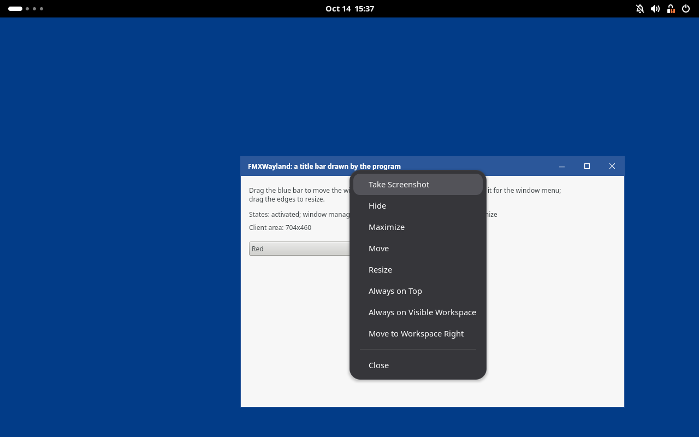 | 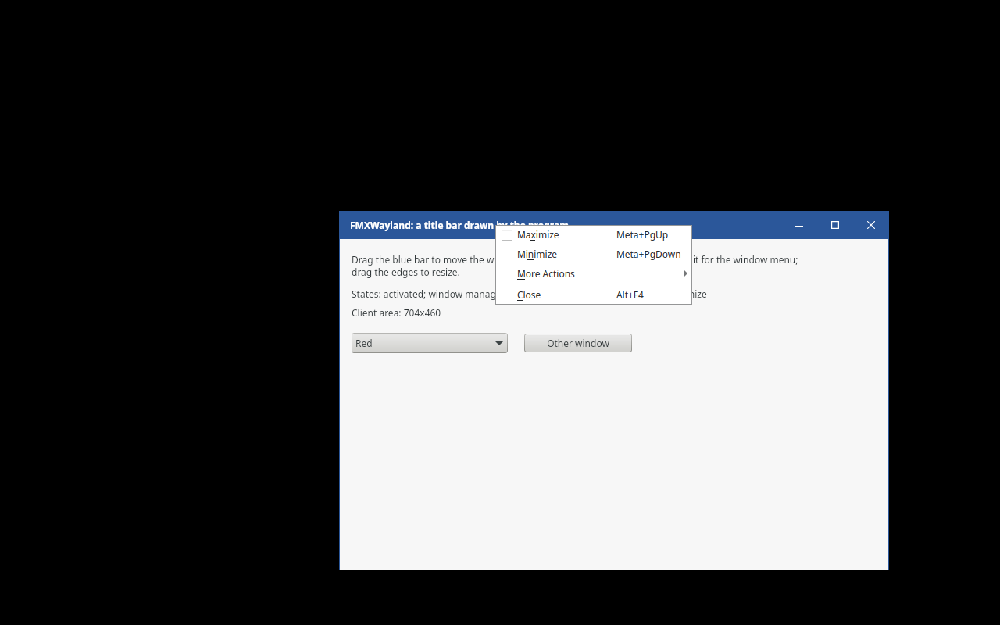 |

## Status

Tested on WSLg (Weston-based, RDP; xdg_wm_base 1, no xdg-decoration, no cursor-shape, no fractional-scale), and
headless on Weston 9, 10, 14, 15, sway 1.11, KWin 6.6 and GNOME Shell 50 (see [Compositors](#compositors)); the cairo
canvas on Weston 14 and sway 1.11. 104 of 186 FMUX functions are assigned (77 fully, 27 partly); the full list:
[docs/FMUX-STATUS.md](docs/FMUX-STATUS.md).

| Area | FMUX functions | Status |
|---|---|---|
| Application, loop, threads | FmuxInit, FmuxRun, FmuxHandleMessage, FmuxTerminate, FmuxWakeMainThread, FmuxGetKeyState, FmuxGet/SetVersionInfo | implemented |
| Timers | FmuxCreateTimer, FmuxDestroyTimer | implemented |
| Windows | FmuxCreateWindow, FmuxDestroyWindow, FmuxShowWindow, FmuxSetWindowState, FmuxSetWindowTitle, FmuxGet/SetClientSize, FmuxGetWindowRect, FmuxInvalidateRect, FmuxProcessUpdates, FmuxClientToScreen, FmuxScreenToClient, FmuxGetWindowScale, FmuxGet/SetWindowFullScreen, FmuxShowModal, FmuxSetMainWindow | implemented |
| Windows (Wayland limits) | FmuxSetWindowRect (position virtual), FmuxActivateWindow/FmuxWindowBringToFront (xdg-activation request), FmuxWindowSendToBack (no-op), FmuxSetWindowIcon (ignored), FmuxSetCapture/ReleaseCapture (implicit grab), FmuxGetWindowNativeHandle/DrawingHandle (wl_surface) | partial |
| Popups | through FmuxCreateWindow (Popup) / FmuxShowWindow | implemented (xdg_popup, no grab; made once the parent window is mapped) |
| Screens | FmuxGetScreenSize, FmuxGetScreenScale, FmuxGetDisplayFromWindow, FmuxGetDisplayFromPoint; FmuxGetDisplayInfo (work area = output) | implemented / partial |
| Mouse, cursor | FmuxGetMousePos (partial: last position over an own window), FmuxSetCursor | implemented |
| Keyboard | (FmuxKey callback): xkbcommon, repeat, compose, layout-independent shortcuts | implemented |
| Painting, bitmaps (both canvases) | FmuxBitmapCreate, FmuxBitmapDestroy, FmuxGetBitmapInfo, FmuxCanvasDrawBitmap | implemented |
| FMX's default canvas (cairo, Pango, gdk-pixbuf) | FmuxCreateContext, FmuxDestroyContext, FmuxSave/Restore, FmuxSetClipRects, FmuxIntersect/ExcludeClipRect, FmuxCanvas* (paths, fills, strokes, dashes, gradients, bitmap brushes, matrix, quality, clear, PtInPath), FmuxCreateTextLayout ... FmuxLayoutToPath, FmuxBitmapLoad, FmuxBitmapSave | implemented |
| Clipboard | FmuxClipboardHas/Get/SetText | implemented |
| Clipboard, other formats | FmuxClipboardHas/GetImage, FmuxClipboardHas/GetCustom (report "none"); FmuxClipboardSetImage/SetCustom/SetArray | partial / stub |
| Dialogs | FmuxFilesDialog (portal's file dialog, FMX's own without a portal) | implemented |
| Dialogs | FmuxMessageDialog (FMX's own dialog form, or the backend's), FmuxInputQuery (the backend's; FMX uses its own input query anyway) | partial |
| IME | FmuxImeEnterControl/ExitControl/SetCaretPos (no-ops: characters come from xkbcommon) | partial |
| Tooltips, gestures | FmuxAddTooltip/RemoveTooltip, FmuxAdd/RemoveGestureRecognizer (no-ops) | partial |
| OpenGL contexts, PDF canvas | FmuxCreateSharedContext, FmuxCreateThreadContext, FmuxMakeCurrentContext, FmuxFlushBuffer, FmuxCreatePDFContext... | stub |
| Fonts | FmuxGetFontCount, FmuxGetFontName (the system's families); FmuxAddCustomFont, FmuxAddCustomFontFromData; FMX's IFMXSystemFontService (default font: GNOME's font-name through the settings portal, else fontconfig's sans-serif) | partial / stub; service implemented |
| Main menu (native menu bar) | FmuxCreateMainMenu, FmuxCreateMenu, FmuxCreateMenuItem, FmuxMenuAddItem, FmuxSetSubmenu, FmuxUpdateMenuItem | stub (no menu bar shown) |
| Printing, PDF | FmuxEnumPrinters ... FmuxSetAlwaysAskOutputFile | stub |
| Web view, media, video capture | FmuxCreateWebView..., FmuxCreateMedia..., FmuxCaptureDeviceEnum... | stub |
| Shell | FmuxOpenFile, FmuxOpenUrl, FmuxGetFileIcon, FmuxGetFileType | stub |
| Drag and drop | FmuxBeginDragDrop (and the Drag callback) | stub |
| Synthetic events, screenshots | FmuxGen*, FmuxTakeScreenshot, FmuxGetCursor... | stub |

## What does not work yet

- FMX's default canvas: custom fonts (`TFontManager` / `FmuxAddCustomFont`: fontconfig application fonts are not
  wired yet), printing and PDF (`FmuxCreatePDFContext`), OpenGL contexts. Pango spaces wrapped lines by the font's
  metrics, a little wider than Skia for some fonts (Ubuntu); FMX's own dialogs size themselves to it.
- `TMainMenu` (a native menu bar under GTK): not shown. Popup menus (`TPopupMenu`) are FMX forms and work.
- External presentation (FastCanvas): no frame callbacks drive FMX's paints of such a window (FMX paints when it
  invalidates; with `MAILBOX` the presenter may draw more frames than the output shows); the acknowledgement of a
  configure is sent next to the new size's state, not in the presenter's commit, so a commit of the presenter's
  thread can still fall between the two (a window going from one maximized size to another: not seen in the tests);
  popups and transparent forms of a GPU canvas go through FMXWayland's frames (FastCanvas reads them back); tested on
  lavapipe only (WSL has no GPU driver with Wayland presentation).
- Drag and drop (also between applications), clipboard images and custom formats, IME (text-input-v3), touch and
  gestures, tooltips, window icons, printing, web browser, media player.
- File dialogs: a multiple selection through `TOpenDialog` keeps what fits into FMX's 1024 characters; the portal's
  dialogs always ask before overwriting; `TSaveDialog.DefaultExt` is not passed by FMX. FMX's own file dialog has
  no places/bookmarks, icons or previews.
- Window positions are not under the program's control (Wayland); `Position = poScreenCenter` and the like have no
  effect. Popups do not grab the pointer (xdg_popup.grab): they close like other FMX popups (a click elsewhere in
  the program, or the form losing activation when another application is clicked).
- Scale changes after start (moving a window to a monitor with another scale) are reported to FMX with
  `TScaleChangedMessage`; tested only in the form of new windows getting the fractional scale after the output's
  integer one (fractional scaling itself is tested on sway, KWin and GNOME Shell at 1.5).
- `FmuxActivateWindow`/`FmuxWindowBringToFront` ask for activation with an xdg-activation token tied to the last
  input event; the compositor decides (sway only marks the window urgent unless `focus_on_window_activation focus`;
  KWin and GNOME Shell focus it). Without an input event yet (no serial) compositors may refuse.
- On compositors without maximize (sway: `wm_capabilities` lists only fullscreen) `WindowState := wsMaximized` is
  ignored by the compositor while FMX keeps `wsMaximized`.
- `IFMXWaylandWindowFrame`: no touch (FMXWayland has no `wl_touch` yet; only pointer presses start moves and
  resizes); no window geometry insets for shadows and invisible resize borders outside the window (a later interface).
  A move starts on the drag, not at the press (see the table): a program that waits for the compositor's grab at the
  press itself sees it a few pixels later.
- The default font follows the desktop's only in GNOME (its `font-name`, read once at start: a change later is not
  followed; `text-scaling-factor` is not applied). Elsewhere (KDE, sway, ...) the size is FMX's 12
  device-independent pixels, not the desktop's (fontconfig's match carries none).
- A popup opened before its window is on the screen (from a timer, `FormCreate`) waits for the window; compositors
  that activate the new window then (sway, KWin, GNOME Shell) make FMX close it again: FMX closes the popups of a form
  whenever its activation changes (FMX.Platform.Linux, as with libfmux).
- FMX frees a form's controls after its window handle: a form freed while a combo box's drop-down is open (closed by
  code, not by the user, whose close goes through FMX's popup handling first) ends in an access violation in FMX
  (`TCustomForm.DoRemoveObject` asks the gone window for its client size; on Windows the same program hangs at
  exit, so it is FMX's, not FMXWayland's to fix). Close the drop-downs of a form before freeing it from code, e.g.:

  ```pascal
  procedure CloseDropDowns(const ARoot: TFmxObject); // uses FMX.ListBox, FMX.ComboEdit
  var
    I: Integer;
  begin
    if (ARoot is TCustomComboBox) and TCustomComboBox(ARoot).DroppedDown then
      TCustomComboBox(ARoot).DropDown // toggles: closes the open list
    else if (ARoot is TCustomComboEdit) and TCustomComboEdit(ARoot).DroppedDown then
      TCustomComboEdit(ARoot).CloseDropDown;
    for I := 0 to ARoot.ChildrenCount - 1 do
      CloseDropDowns(ARoot.Children[I]);
  end;
  ```

  FMR Ribbon does this for its forms (`FmrCloseDropDowns` in `FMR.Ribbon.Editors`).

## Next steps

1. **External presentation**: pacing by the compositor (an `IFMXWaylandNativeWindow2` through which the presenter
   tells FMXWayland that it committed a frame, so that frame callbacks drive FMX's paints as with wl_shm frames;
   now FMX paints at the pace of its invalidations), and the acknowledgement of a configure in the presenter's own
   commit (now FMXWayland sends it next to the new size's state: a commit of the presenter's thread can fall in
   between).
2. **IME** with text-input-unstable-v3 (the protocol unit exists): FmuxImeEnterControl/ExitControl/SetCaretPos to
   `enable`/`set_cursor_rectangle`, preedit to FMX's marked text.
3. **Decorations**: polish the client-side ones (shadows, theme colors, `prefers-color-scheme` through the portal).
   xdg-decoration where offered, the tests on KWin, sway and GNOME Shell and `IFMXWaylandWindowFrame` for programs
   with their own title bar are done; next for it: window geometry insets (shadows, resize borders outside the
   window), the desktop's dark/light preference (settings portal; GNOME's font is read through it already).
4. **Drag and drop** over wl_data_device (FMX's Drag callback, FmuxBeginDragDrop), clipboard images and custom
   formats, primary selection.
5. `FmuxOpenUrl`/`FmuxOpenFile` through the OpenURI portal (the D-Bus client is there) or `xdg-open`; the dark style
   preference through the Settings portal.
6. **Menus**: draw `TMainMenu` as an FMX menu bar inside the window.
7. Popup grabs (`xdg_popup.grab` for menus), `xdg_popup.reposition` (version 3), window icons
   (xdg-toplevel-icon), touch (wl_touch -> FMX touch/gesture callbacks).
8. **X11 fallback backend** sharing the FMX adapter (`FMXWayland.Fmux` talks to the Wayland core through
   `TWlWindow`'s events; an X11 core with the same shape would plug in).
9. Packaging: a design-time/package setup so the IDE builds Linux FMX projects with FMXWayland without copying paths.

## Contributors

- **[Hemul GM](https://github.com/HemulGM)** — FMX's default Linux canvas on cairo, Pango and gdk-pixbuf
  (`FMXWayland.Cairo`, `FMXWayland.CairoApi`): ordinary FMX programs draw on FMXWayland without Skia; dialogs
  (`FMXWayland.DBus`, `FMXWayland.Portal`, `FMXWayland.Dialogs`, `FMXWayland.DialogTypes`, `FMXWayland.FileDialog`):
  a D-Bus client in Pascal, the xdg-desktop-portal file dialogs, FMX's own file dialog and the replaceable dialog
  backend.

Thank you!

## License

MIT, see [LICENSE](LICENSE). Third-party notices: [THIRD_PARTY_NOTICES.md](THIRD_PARTY_NOTICES.md).
